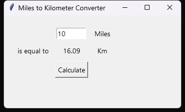
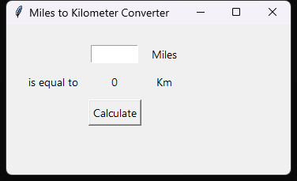

# 🚀 Miles to Kilometer Converter

A small Tkinter application that converts miles to kilometers: type a distance, press **Calculate**, read the result. It is the day 27 assignment of Udemy's *100 Days of Code: The Complete Python Pro Bootcamp*, written for fellow course participants and repository visitors, with no runtime dependencies.



## 📚 Table of Contents

- [Overview](#-overview)
- [Requirements](#-requirements)
- [Setup](#-setup)
- [Run](#-run)
- [Tests](#-tests)
- [Continuous integration](#continuous-integration)
- [Build the source documentation](#build-the-source-documentation)
- [Project layout](#project-layout)
- [License](#-license)
- [Links](#-links)
- [Appendix: Project documents](#-appendix-project-documents)

## 🧭 Overview

The window has an entry for miles, a result label in kilometers and a **Calculate** button. The conversion rule (`miles_to_km`) is kept apart from the window, so it can be tested without a display. The factor 1.609 and every text of the window live in `constants.py`. The wiki has the same instructions in English, Danish and Bahasa Malaysia: see [Links](#-links).



## 📋 Requirements

- Python 3.13 or newer, with Tkinter (`tkinter` ships with the Windows and macOS installers; on Debian it is the `python3-tk` package).
- No runtime packages. The tests need `pytest`, which is installed by the `dev` extra below.
- Optional: [Doxygen](https://www.doxygen.nl/) to build the source documentation.

## 🛠️ Setup

Create a local virtual environment named `.venv` in the repository root, upgrade `pip` inside it, then install the project in editable mode with the test tools.

### Windows PowerShell

```powershell
python -m venv .venv
.\.venv\Scripts\Activate.ps1
python -m pip install --upgrade pip
python -m pip install -e ".[dev]"
```

If PowerShell refuses to run the activation script, allow it for the current session with `Set-ExecutionPolicy -Scope Process -ExecutionPolicy RemoteSigned`.

### Linux Debian

```bash
sudo apt install python3 python3-venv python3-tk
python3 -m venv .venv
source .venv/bin/activate
python -m pip install --upgrade pip
python -m pip install -e ".[dev]"
```

### MacOS

```bash
python3 -m venv .venv
source .venv/bin/activate
python -m pip install --upgrade pip
python -m pip install -e ".[dev]"
```

Leave the environment with `deactivate`.

## ▶️ Run

With the environment active:

```bash
python -m mile2km
```

Or, without installing, from the repository root: `PYTHONPATH=src python -m mile2km` (Linux, macOS) or `$env:PYTHONPATH = "src"; python -m mile2km` (PowerShell).

Enter a distance in miles and press **Calculate**. Text that is not a number shows "Enter a number".

## 🧪 Tests

Run the tests with the environment active:

```bash
python -m pytest
```

The GUI tests are skipped when Tkinter or a display is not available; the conversion tests always run.

## Continuous integration

`.gitea/workflows/ci.yml` creates a virtual environment on Python 3.13, installs `.[dev]` and runs `python -m pytest` on every pull request and every push to `main`. It needs no secrets. The GUI tests are skipped on the runner because it has no Tk library.

## Build the source documentation

The source carries Doxygen comments and the repository has a `Doxyfile`. With Doxygen installed:

```bash
doxygen Doxyfile
```

The HTML is written to `docs/doxygen/html/index.html` (the folder is not committed).

## Project layout

| Path | Content |
| --- | --- |
| `src/mile2km/constants.py` | Every constant: the factor, texts and padding |
| `src/mile2km/converter.py` | The conversion rule, free of any user interface |
| `src/mile2km/gui.py` | The Tkinter window and `button_clicked` |
| `src/mile2km/__main__.py` | Entry point for `python -m mile2km` |
| `tests/` | pytest tests of the conversion, the window and the CI workflow |
| `docs/` | Project documents, review records and screenshots |
| `Doxyfile` | Doxygen configuration |
| `pyproject.toml` | Project configuration, with no runtime dependencies |
| `.gitea/workflows/ci.yml` | Continuous integration |

## 📄 License

GNU Affero General Public License v3.0, see [LICENSE][license].

## 🔗 Links

- [Repository][repository]
- [Documentation][documentation] (wiki in English, Danish and Bahasa Malaysia)
- [Issue tracker][issues]

## 📎 Appendix: Project documents

| Document | What it tells you |
| --- | --- |
| [AGENTS.md][agents] | The rules AI agents follow in this repository |
| [Business Case][BC-001] | Why the project exists, its scope and success criteria |
| [Stakeholder Analysis][SA-001] | Who is involved; the stakeholder IDs used for owners and reviewers |
| [Project Plan][PP-001] | The gateways and their schedule |
| [Milestones][milestones] | One document per gateway: Go/No-Go criteria and tasks |
| [Artifact registry][registry] | Where each artifact type lives, the next version, the PO language and domain |
| [Framework README][framework-readme] | The framework this project uses |
| [Framework changelog][framework-changelog] | What changed in each framework release |

---

[repository]: https://git.tirsystem.com/Tirsvad-Udemy-100-days-of-code/027-mile2km-converter
[documentation]: https://git.tirsystem.com/Tirsvad-Udemy-100-days-of-code/027-mile2km-converter/wiki
[issues]: https://git.tirsystem.com/Tirsvad-Udemy-100-days-of-code/027-mile2km-converter/issues
[license]: ./LICENSE
[agents]: ./AGENTS.md
[BC-001]: ./docs/business-case.md
[SA-001]: ./docs/stakeholder-analysis.md
[PP-001]: ./docs/project-plan.md
[milestones]: ./docs/milestones/
[registry]: ./docs/artifact-registry.md
[framework-readme]: ./framework/README.md
[framework-changelog]: ./framework/CHANGELOG.md
