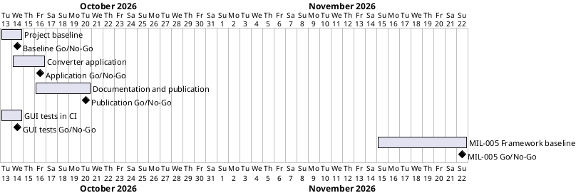

# Project Plan

## Metadata
| Key | Value |
| --- | --- |
| ID | PP-001 |
| CrossReference | [BC-001], [SA-001], [MIL-001], [MIL-002], [MIL-003], [MIL-004], [MIL-005] |
| Language | en |
| Domain | education |

## Version History
| Date | Status | Author | Reviewer | Change | Commit |
| --- | --- | --- | --- | --- | --- |
| 2026-10-13 | Deprecated | Jens Tirsvad Nielsen | S01 | Initial version; accepted by S01 in chat on 2026-10-13 | [04cc0e3] |
| 2026-11-15 | Accepted | Jens Tirsvad Nielsen | AI as stand-in for S01 | Added the gateway MIL-004 that was missing from the plan and the baseline gateway MIL-005, with their schedule, scope coverage, dependency, risk and Gantt entries; linked the git host milestones of MIL-001 to MIL-004; set the domain to education; reviewed in autonomous mode, not independent | pending |

---

## Purpose

Schedule the three phases that take the Day 27 miles-to-kilometers converter from an empty repository to a published, documented project, within the one-working-day effort in [BC-001].

Two gateways were added later: [MIL-004] (the GUI tests in the CI run, 2026-10-13 to 2026-10-14) and [MIL-005], added on 2026-11-15 to bring the finished project to the baseline of the framework; it runs from 2026-11-15 to 2026-11-22.

## Planning Assumptions

- The plan is accepted on 2026-10-13 and work starts the same day.
- Each phase is one pull request, merged by the AI as stand-in for S01 in autonomous mode once checks are green.
- Phases are short (one to three days) because the application is small.
- The baseline gateway [MIL-005] starts 2026-11-15 and ends by 2026-11-22, one week (source: [BC-001], Assumptions). The end date of the plan moves from 2026-10-20 to 2026-11-22 because of it; the reason is the agreed minimum quality baseline of the framework.
- For [MIL-005] S01 has authorised the assistant to commit, push, open the pull request and merge it, and the review is done by an AI stand-in for S01 (source: [BC-001], Constraints; [SA-001], Conflicting Interests and Mitigations).

## Gateway Schedule

| Gateway | Document | Window | Decision date | Owner | Stories | Main deliverable | Milestone |
| --- | --- | --- | --- | --- | --- | --- | --- |
| Project baseline | [MIL-001] | 2026-10-13 to 2026-10-14 | 2026-10-14 | S01 | none | pyproject, .gitignore, Doxyfile, layout, CI | [milestone-135] |
| Converter application | [MIL-002] | 2026-10-14 to 2026-10-16 | 2026-10-16 | S01 | none | constants, conversion, Tkinter GUI, tests | [milestone-136] |
| Documentation and publication | [MIL-003] | 2026-10-16 to 2026-10-20 | 2026-10-20 | S01 | none | README, screenshots, wiki en/da/ms, Doxygen, repository metadata | [milestone-137] |
| GUI tests in CI | [MIL-004] | 2026-10-13 to 2026-10-14 | 2026-10-14 | S01 | none | The CI workflow runs the Tkinter window tests under a virtual display | [milestone-145] |
| Framework baseline | [MIL-005] | 2026-11-15 to 2026-11-22 | 2026-11-22 | S01 | none | The framework release, the wiki in three languages, the links to the project documents in the README, the licence metadata, the traceability matrix and the review records | [milestone-538] |



## Scope Coverage

| Business Case scope item | Gateway |
| --- | --- |
| Python application in `src/`, tests in `tests/` | [MIL-002] |
| `constants.py` | [MIL-002] |
| `pyproject.toml`, `.gitignore`, `Doxyfile` | [MIL-001] |
| Continuous-integration workflow | [MIL-001] |
| README and trilingual wiki with screenshots | [MIL-003] |
| Repository description and topics | [MIL-003] |
| Continuous-integration workflow runs the window tests too | [MIL-004] |
| The baseline milestone: framework release, wiki, licence metadata, traceability matrix, review records | [MIL-005] |

## Dependencies

```
MIL-001 → MIL-002 → MIL-003
MIL-002 → MIL-004
MIL-003 → MIL-005
MIL-004 → MIL-005
```

A No-Go on a gateway moves every later date by the rework time; nothing under `src/` or `tests/` starts before MIL-001 is accepted.

[MIL-005] documents and baselines the finished converter and changes no code. A No-Go on it leaves the converter and the earlier gateways as they are, and S01 decides a new date.

## Plan Risks

| Risk | Impact | Mitigation |
| --- | --- | --- |
| Git host token or wiki not available | MIL-003 cannot publish | stop and report per the autonomous-mode rules |
| Doxygen not installed on the machine | The build cannot be verified | record the absence in the review and rely on the Doxyfile syntax |
| CI runner not available on the host | CI cannot be shown green | record it in the pull request; the local pytest run is the evidence |
| A continuous integration (CI) check fails on the pull request of [MIL-005] | The merge is delayed past 2026-11-22 | The failure is fixed on the same branch and the checks run again; after three failed rounds on one cause the work stops and S01 decides (trace: success criterion 6 of [BC-001]) |

## Open Issues

- The requested repository URL (`Tirsvad-Udemy-100_days_of_code`) differs from this clone's `origin` (`Tirsvad-Udemy-100-days-of-code/027-mile2km-converter`); the plan uses `origin`.
- No use cases or user stories are modelled: the application has a single interaction, covered by [BC-001] objective 1, so all tasks are plain tasks.
- The Product Owner's language is recorded as English from the language of the request.
- **Published wiki:** the wiki is checked on the git host after the merge, because the host copies it only then.

---

[BC-001]: ./business-case.md
[SA-001]: ./stakeholder-analysis.md
[MIL-001]: ./milestones/mil-001-project-baseline.md
[MIL-002]: ./milestones/mil-002-converter-application.md
[MIL-003]: ./milestones/mil-003-documentation-and-publication.md
[04cc0e3]: https://git.tirsystem.com/Tirsvad-Udemy-100-days-of-code/027-mile2km-converter/commit/04cc0e3e8494b836cd6445d64b0ff967354b2545
[MIL-004]: ./milestones/mil-004-ci-gui-tests.md
[MIL-005]: ./milestones/mil-005-framework-baseline.md
[milestone-135]: https://git.tirsystem.com/Tirsvad-Udemy-100-days-of-code/027-mile2km-converter/milestone/135
[milestone-136]: https://git.tirsystem.com/Tirsvad-Udemy-100-days-of-code/027-mile2km-converter/milestone/136
[milestone-137]: https://git.tirsystem.com/Tirsvad-Udemy-100-days-of-code/027-mile2km-converter/milestone/137
[milestone-145]: https://git.tirsystem.com/Tirsvad-Udemy-100-days-of-code/027-mile2km-converter/milestone/145
[milestone-538]: https://git.tirsystem.com/Tirsvad-Udemy-100-days-of-code/027-mile2km-converter/milestone/538
