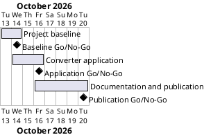

# Project Plan

## Metadata
| Key | Value |
| --- | --- |
| ID | PP-001 |
| CrossReference | [BC-001], [SA-001], [MIL-001], [MIL-002], [MIL-003] |
| Language | en |
| Domain | it |

## Version History
| Date | Status | Author | Reviewer | Change | Commit |
| --- | --- | --- | --- | --- | --- |
| 2026-10-13 | Accepted | Jens Tirsvad Nielsen | S01 | Initial version; accepted by S01 in chat on 2026-10-13 | pending |

---

## Purpose

Schedule the three phases that take the Day 27 miles-to-kilometers converter from an empty repository to a published, documented project, within the one-working-day effort in [BC-001].

## Planning Assumptions

- The plan is accepted on 2026-10-13 and work starts the same day.
- Each phase is one pull request, merged by the AI as stand-in for S01 in autonomous mode once checks are green.
- Phases are short (one to three days) because the application is small.

## Gateway Schedule

| Gateway | Document | Window | Decision date | Owner | Stories | Main deliverable | Milestone |
| --- | --- | --- | --- | --- | --- | --- | --- |
| Project baseline | [MIL-001] | 2026-10-13 to 2026-10-14 | 2026-10-14 | S01 | none | pyproject, .gitignore, Doxyfile, layout, CI | |
| Converter application | [MIL-002] | 2026-10-14 to 2026-10-16 | 2026-10-16 | S01 | none | constants, conversion, Tkinter GUI, tests | |
| Documentation and publication | [MIL-003] | 2026-10-16 to 2026-10-20 | 2026-10-20 | S01 | none | README, screenshots, wiki en/da/ms, Doxygen, repository metadata | |



## Scope Coverage

| Business Case scope item | Gateway |
| --- | --- |
| Python application in `src/`, tests in `tests/` | [MIL-002] |
| `constants.py` | [MIL-002] |
| `pyproject.toml`, `.gitignore`, `Doxyfile` | [MIL-001] |
| Continuous-integration workflow | [MIL-001] |
| README and trilingual wiki with screenshots | [MIL-003] |
| Repository description and topics | [MIL-003] |

## Dependencies

```
MIL-001 → MIL-002 → MIL-003
```

A No-Go on a gateway moves every later date by the rework time; nothing under `src/` or `tests/` starts before MIL-001 is accepted.

## Plan Risks

| Risk | Impact | Mitigation |
| --- | --- | --- |
| Git host token or wiki not available | MIL-003 cannot publish | stop and report per the autonomous-mode rules |
| Doxygen not installed on the machine | The build cannot be verified | record the absence in the review and rely on the Doxyfile syntax |
| CI runner not available on the host | CI cannot be shown green | record it in the pull request; the local pytest run is the evidence |

## Open Issues

- The requested repository URL (`Tirsvad-Udemy-100_days_of_code`) differs from this clone's `origin` (`Tirsvad-Udemy-100-days-of-code/027-mile2km-converter`); the plan uses `origin`.
- No use cases or user stories are modelled: the application has a single interaction, covered by [BC-001] objective 1, so all tasks are plain tasks.
- The Product Owner's language is recorded as English from the language of the request.

---

[BC-001]: ./business-case.md
[SA-001]: ./stakeholder-analysis.md
[MIL-001]: ./milestones/mil-001-project-baseline.md
[MIL-002]: ./milestones/mil-002-converter-application.md
[MIL-003]: ./milestones/mil-003-documentation-and-publication.md
